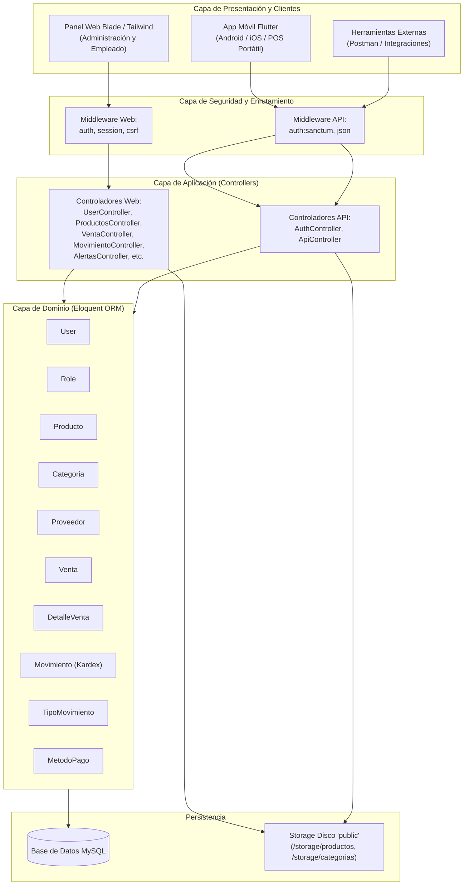
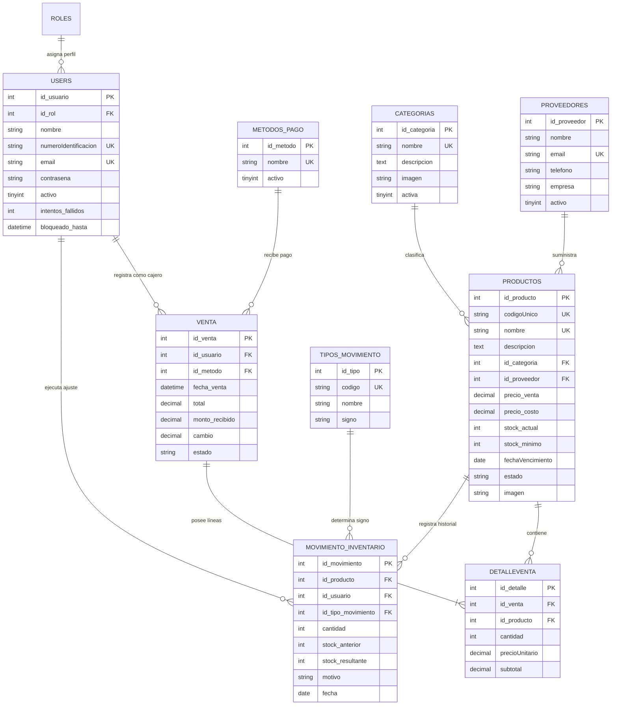
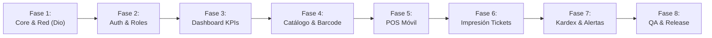

# Documentación Técnica Integral del Sistema SIGI y Plan de Desarrollo Móvil Flutter

> **SIGI** (*Sistema de Información y Gestión Integrado de Inventario y Ventas*)  
> **Versión del Sistema**: 2.0  
> **Backend Framework**: Laravel 11/12 (PHP 8.3+)  
> **Autenticación API**: Laravel Sanctum v4 (Bearer Tokens)  
> **Base de Datos**: MySQL / MariaDB  

---

## Índice General

1. [Ficha Técnica y Resumen Ejecutivo](#1-ficha-técnica-y-resumen-ejecutivo)
2. [Arquitectura de Software y Topología del Sistema](#2-arquitectura-de-software-y-topología-del-sistema)
3. [Matriz de Roles y Niveles de Acceso](#3-matriz-de-roles-y-niveles-de-acceso)
4. [Modelo de Datos y Diccionario de Clases Eloquent](#4-modelo-de-datos-y-diccionario-de-clases-eloquent)
5. [Controladores, Funciones y Lógica de Negocio](#5-controladores-funciones-y-lógica-de-negocio)
6. [Catálogo Completo de Rutas y Endpoints API REST](#6-catálogo-completo-de-rutas-y-endpoints-api-rest)
7. [Módulos Funcionales del Sistema](#7-módulos-funcionales-del-sistema)
8. [Plan Maestro de Desarrollo para la App Móvil en Flutter](#8-plan-maestro-de-desarrollo-para-la-app-móvil-en-flutter)
9. [Guía de Integración Técnica y Ejemplos en Dart](#9-guía-de-integración-técnica-y-ejemplos-en-dart)
10. [Pruebas Automatizadas y Colección Postman](#10-pruebas-automatizadas-y-colección-postman)

---

## 1. Ficha Técnica y Resumen Ejecutivo

**SIGI** es una solución integral diseñada para la optimización de procesos comerciales, administración de catálogos multitienda, monitoreo preventivo de niveles de existencias y facturación rápida en mostradores físicos o puntos de venta itinerantes.

El sistema combina:
* Una consola web de administración avanzada para gerencia y control de inventarios.
* Una terminal transaccional de punto de venta (POS) optimizada con bloqueo concurrente y emisión de tickets.
* Una capa de servicios API RESTful desacoplada para clientes móviles (smartphones y terminales POS Android/iOS).
* Un motor de auditoría perpetua (Kardex) que rastrea cada alteración de stock (entradas, salidas por ventas y ajustes físicos).

---

## 2. Arquitectura de Software y Topología del Sistema

El ecosistema opera bajo un patrón **híbrido desacoplado**:
* **Backend Monolítico Web**: Laravel MVC tradicional gestiona las vistas de administración interna mediante Blade, Tailwind CSS y componentes interactivos.
* **Capa de Servicios API RESTful**: Expone endpoints sin estado (*stateless*), protegidos por Laravel Sanctum mediante cabeceras `Authorization: Bearer <token>`.
* **Capa de Persistencia Relacional**: MySQL/MariaDB con restricciones de integridad referencial, transacciones ACID obligatorias (`DB::transaction`) y bloqueos pesimistas (`lockForUpdate()`).



---

## 3. Matriz de Roles y Niveles de Acceso

El control de acceso se basa en el modelo `Role` y la columna `id_rol` de la tabla `users`. El enrutamiento web (`/dashboard`) y los endpoints de la API reconocen el rol del usuario para restringir o habilitar capacidades:

| Rol | `id_rol` | Perfil de Usuario | Capacidades y Alcance |
| :--- | :---: | :--- | :--- |
| **Administrador** | `1` | Gerente / Propietario / Auditor | **Acceso Total**: Visualización del dashboard financiero con volumen de ingresos y métricas globales; creación, edición y activación/desactivación de usuarios; mantenimiento de proveedores, categorías y catálogo de productos; consulta del Kardex completo; auditoría global de ventas; gestión de métodos de pago; configuración general y módulo de alertas críticas. |
| **Empleado** | `2` | Cajero / Dependiente de Mostrador | **Acceso Operativo**: Acceso a la terminal de ventas POS; consulta ágil de productos con verificación de stock disponible en tiempo real; registro de cobros; consulta de ventas propias registradas por su turno ("Mis Ventas"); visualización de ingresos acumulados en el día por su caja. No puede eliminar usuarios, modificar costos ni alterar configuraciones de la plataforma. |

---

## 4. Modelo de Datos y Diccionario de Clases Eloquent

El esquema de base de datos utiliza claves primarias explícitas personalizadas (`id_*`) en lugar del estándar autoincremental `id`.



### Especificación de Modelos

1. **`User` (`app/Models/User.php`)**
   * Tabla: `users` | Clave Primaria: `id_usuario`.
   * Campos fillable: `id_rol`, `nombre`, `numeroIdentificacion`, `email`, `contrasena`, `activo`, `intentos_fallidos`, `bloqueado_hasta`.
   * Seguridad: Implementa `Laravel\Sanctum\HasApiTokens`. Sobrescribe `getAuthPassword()` para validar contra el campo `contrasena`. Encriptación automática mediante cast `'contrasena' => 'hashed'`. Accessors para `name` y `role_id`.
   * Relaciones: `belongsTo(Role::class, 'id_rol', 'id_rol')`.

2. **`Role` (`app/Models/Role.php`)**
   * Tabla: `roles` | Clave Primaria: `id_rol`.
   * Campos fillable: `id_rol`, `nombre`, `descripcion`.
   * Relaciones: `hasMany(User::class, 'id_rol')`.

3. **`Producto` (`app/Models/Producto.php`)**
   * Tabla: `productos` | Clave Primaria: `id_producto`.
   * Campos fillable: `codigoUnico`, `nombre`, `descripcion`, `id_categoria`, `id_proveedor`, `precio_venta`, `precio_costo`, `stock_minimo`, `stock_actual`, `fechaCreacion`, `fechaVencimiento`, `estado`, `imagen`.
   * Reglas de estado: `'activo'`, `'inactivo'`, `'agotado'`.
   * Relaciones: `belongsTo(Categoria::class, 'id_categoria')`, `belongsTo(Proveedor::class, 'id_proveedor')`.

4. **`Categoria` (`app/Models/Categoria.php`)**
   * Tabla: `categorias` | Clave Primaria: `id_categoria`.
   * Campos fillable: `nombre`, `descripcion`, `imagen`, `activa`.
   * Relaciones: `hasMany(Producto::class, 'id_categoria')`.

5. **`Proveedor` (`app/Models/Proveedor.php`)**
   * Tabla: `proveedores` | Clave Primaria: `id_proveedor`.
   * Campos fillable: `nombre`, `telefono`, `email`, `empresa`, `activo`, `fecha_registro`.

6. **`MetodoPago` (`app/Models/MetodoPago.php`)**
   * Tabla: `metodos_pago` | Clave Primaria: `id_metodo`.
   * Campos fillable: `nombre`, `activo`.
   * Relaciones: `hasMany(Venta::class, 'id_metodo')`.

7. **`TipoMovimiento` (`app/Models/TipoMovimiento.php`)**
   * Tabla: `tipos_movimiento` | Clave Primaria: `id_tipo`.
   * Campos fillable: `codigo` (`ENTRADA`, `SALIDA`, `AJUSTE`), `nombre`, `signo` (`+` o `-`).
   * Relaciones: `hasMany(Movimiento::class, 'id_tipo_movimiento')`.

8. **`Movimiento` (`app/Models/Movimiento.php`)**
   * Tabla: `movimiento_inventario` | Clave Primaria: `id_movimiento`.
   * Campos fillable: `id_producto`, `id_usuario`, `id_tipo_movimiento`, `cantidad`, `stock_anterior`, `stock_resultante`, `motivo`, `fecha`.
   * Relaciones: `belongsTo(Producto::class)`, `belongsTo(User::class)`, `belongsTo(TipoMovimiento::class)`.

9. **`Venta` (`app/Models/Venta.php`)**
   * Tabla: `venta` | Clave Primaria: `id_venta`.
   * Campos fillable: `id_usuario`, `id_metodo`, `fecha_venta`, `total`, `monto_recibido`, `cambio`, `estado`.
   * Casts: decimal de 2 posiciones para totales y moneda.
   * Relaciones: `belongsTo(User::class)`, `belongsTo(MetodoPago::class)`, `hasMany(DetalleVenta::class, 'id_venta')`.

10. **`DetalleVenta` (`app/Models/DetalleVenta.php`)**
    * Tabla: `detalleventa` | Clave Primaria: `id_detalle`.
    * Campos fillable: `id_venta`, `id_producto`, `cantidad`, `precioUnitario`, `subtotal`.
    * Relaciones: `belongsTo(Venta::class)`, `belongsTo(Producto::class)`.

---

## 5. Controladores, Funciones y Lógica de Negocio

### 5.1. Controladores API Móvil (`App\Http\Controllers\Api`)

#### A. `AuthController`
* **`login(Request $request)`**:
  * Valida `email` y `password` (acepta también el alias `contrasena`).
  * Autentica mediante `Auth::attempt()`.
  * Comprueba que la cuenta tenga el flag `activo == 1`.
  * Emite token personal Sanctum `flutter_token` y retorna el objeto de usuario con su rol.
* **`register(Request $request)`**:
  * Registra un nuevo colaborador (rol Empleado `2` por defecto).
  * Hashea la contraseña con `Hash::make()`.
  * Genera el token de sesión inmediata para el dispositivo móvil.
* **`me(Request $request)`**:
  * Retorna los datos del usuario en sesión, su identificador único y perfil.
* **`logout(Request $request)`**:
  * Revoca y elimina el token de acceso actual en `personal_access_tokens`.

#### B. `ApiController`
* **`dashboard()`**:
  * Consolida: conteo de productos activos, conteo de alertas críticas (`stock_actual <= stock_minimo`), ventas realizadas en la fecha y monto recaudado en el día. Incluye las últimas 5 ventas y los 5 productos con mayor urgencia de reposición.
* **`productos(Request $request)`**:
  * Filtros dinámicos por término de búsqueda (`search` en nombre o código de barra), categoría (`id_categoria`), estado y bandera booleana `solo_disponibles` (filtra stock > 0 y activo para el POS). Admite paginación con parámetro `paginate=true`.
* **`productoPorCodigo($codigo)`**:
  * Optimizado para escáneres de código de barras. Busca coincidencia exacta con `codigoUnico` y resuelve la URL pública de la imagen.
* **`guardarProducto(Request $request)` / `actualizarProducto(Request $request, $id)`**:
  * Validación estricta con reglas de unicidad.
  * Almacenamiento seguro de imágenes en `public/productos` mediante `Storage::disk('public')`.
* **`eliminarProducto($id)`**:
  * Prevención de rotura de integridad referencial: si el producto ya cuenta con registros en ventas históricas (`detalleventa`), el sistema lo conmuta a `inactivo` en lugar de borrarlo físicamente.
* **`guardarVenta(Request $request)`**:
  * **Cúspide transaccional**: ejecuta `DB::transaction`.
  * Aplica bloqueo pesimista en fila (`Producto::lockForUpdate()->findOrFail($id)`) para impedir venta de stock inexistente en situaciones de concurrencia.
  * Verifica `stock_actual >= cantidad solicitada`.
  * Inserta cabecera de `venta` y líneas de `detalleventa`.
  * Descuenta el stock y cambia automáticamente a `'agotado'` si el inventario llega a 0.
  * Inserta el registro automático en el Kardex (`movimiento_inventario`) con tipo `SALIDA`.
  * Calcula total, valida que `monto_recibido >= total` y liquida el cambio exacto.
* **`movimientos(Request $request)` & `guardarMovimiento(Request $request)`**:
  * Módulo de auditoría y captura manual de Kardex. Permite ingresar `ENTRADA`, `SALIDA` o `AJUSTE` físico recalculando el `stock_resultante`.
* **`alertas(Request $request)`**:
  * Consulta de productos con existencias por debajo del umbral mínimo, clasificando en 'agotado' (`stock = 0`) o 'bajo stock' (`stock > 0 && stock <= stock_minimo`).

### 5.2. Controladores Web Administrativos (`App\Http\Controllers`)
* **`UserController`**: CRUD de usuarios con control de integridad referencial (captura código MySQL `23000` para recomendar desactivación si tiene movimientos) y alternancia rápida de estado `toggle_status`.
* **`ProductosController` / `CategoriasController` / `ProveedorController`**: Módulos completos de mantenimiento del catálogo comercial, imágenes y proveedores.
* **`VentaController`**: Terminal POS web para administradores con interfaz táctil y teclado.
* **`HistorialVentasController`**: Auditoría general de ventas con filtros avanzados y generación de ticket de venta imprimible (`facturaPOS.blade.php`).
* **`AlertasController`**: Panel de control con contadores de alerta preventiva.
* **`MovimientoController`**: Gestión y visualización de la bitácora de movimientos de almacén.
* **`EmpleadoVentaController` / `EmpleadoConsultaController` / `EmpleadoMisVentasController`**: Rutas y vistas encapsuladas para el perfil operativo de Empleado.

---

## 6. Catálogo Completo de Rutas y Endpoints API REST

Todas las rutas API cuentan con el prefijo automático `/api` definido en `routes/api.php`:

| Método | Endpoint | Controlador y Método | Autenticación | Propósito y Retorno |
| :---: | :--- | :--- | :---: | :--- |
| `POST` | `/api/login` | `AuthController@login` | Pública | Recibe `email` y `password`. Retorna `access_token` y datos de usuario. |
| `POST` | `/api/register` | `AuthController@register` | Pública | Registro de nuevos usuarios con rol Empleado. Emite token de sesión. |
| `GET` | `/api/me` | `AuthController@me` | Sanctum | Retorna información del usuario autenticado actual y su rol. |
| `POST` | `/api/logout` | `AuthController@logout` | Sanctum | Revoca el token Bearer activo en la base de datos. |
| `GET` | `/api/user` | Closure (`$req->user()`) | Sanctum | Devuelve usuario autenticado con la relación de rol precargada. |
| `GET` | `/api/dashboard` | `ApiController@dashboard` | Sanctum | KPIs móviles: productos, ventas de hoy, alertas y top 5 bajo stock. |
| `GET` | `/api/productos/barcode/{codigo}` | `ApiController@productoPorCodigo` | Sanctum | Búsqueda por escáner de código de barras. Retorna 1 producto o 404. |
| `GET` | `/api/productos` | `ApiController@productos` | Sanctum | Catálogo con filtros (`search`, `id_categoria`, `solo_disponibles`). |
| `GET` | `/api/productos/{id}` | `ApiController@producto` | Sanctum | Detalle de un producto con proveedor y categoría. |
| `POST` | `/api/productos` | `ApiController@guardarProducto` | Sanctum | Crea un nuevo producto (soporta carga multipart de imagen). |
| `POST` | `/api/productos/{id}` | `ApiController@actualizarProducto` | Sanctum | Actualiza producto con soporte multipart/form-data. |
| `PUT` | `/api/productos/{id}` | `ApiController@actualizarProducto` | Sanctum | Actualiza producto mediante payload JSON. |
| `DELETE`| `/api/productos/{id}` | `ApiController@eliminarProducto` | Sanctum | Borrado físico o inactivación preventiva si posee ventas previas. |
| `GET` | `/api/categorias` | `ApiController@categorias` | Sanctum | Listado de categorías activas con conteo de productos asignados. |
| `GET` | `/api/categorias/{id}` | `ApiController@categoria` | Sanctum | Detalle de categoría y lista de productos asociados. |
| `POST` | `/api/categorias` | `ApiController@guardarCategoria` | Sanctum | Creación de categoría (con soporte de imagen). |
| `POST`/`PUT`| `/api/categorias/{id}` | `ApiController@actualizarCategoria`| Sanctum | Actualización de nombre, descripción, estado o imagen. |
| `DELETE`| `/api/categorias/{id}` | `ApiController@eliminarCategoria` | Sanctum | Elimina categoría (rechaza con 422 si tiene productos asociados). |
| `GET` | `/api/ventas` | `ApiController@ventas` | Sanctum | Historial de ventas paginado con filtros de fecha, cajero y método. |
| `GET` | `/api/ventas/{id}` | `ApiController@venta` | Sanctum | Detalle completo de una venta para reimpresión de comprobante. |
| `POST` | `/api/ventas` | `ApiController@guardarVenta` | Sanctum | Registro transaccional de venta POS, descuento de stock y Kardex. |
| `GET` | `/api/metodos-pago` | `ApiController@metodosPago` | Sanctum | Métodos de pago activos para poblar selectores en el checkout. |
| `GET` | `/api/alertas` | `ApiController@alertas` | Sanctum | Lista de productos con stock agotado o por debajo del umbral mínimo. |
| `GET` | `/api/movimientos` | `ApiController@movimientos` | Sanctum | Bitácora de Kardex con historial de entradas, salidas y ajustes. |
| `POST` | `/api/movimientos` | `ApiController@guardarMovimiento` | Sanctum | Registro manual de movimiento de inventario (ENTRADA/SALIDA/AJUSTE). |
| `GET` | `/api/proveedores` | `ApiController@proveedores` | Sanctum | Listado de proveedores activos registrados en el sistema. |

---

## 7. Módulos Funcionales del Sistema

1. **Autenticación, Seguridad y Sesión Móvil**:
   * Generación y validación de tokens de acceso Sanctum.
   * Cierre de sesión con revocación de token para evitar reutilización en caso de robo del dispositivo.
   * Verificación obligatoria de cuenta activa (`activo = 1`).
2. **Catálogo de Productos y Escaneo por Código de Barras**:
   * Codificación única por producto (`codigoUnico`).
   * Soporte para escaneo directo mediante la cámara de dispositivos móviles.
   * Almacenamiento y optimización de imágenes en disco público.
3. **Punto de Venta Móvil (POS Transaccional)**:
   * Confección de carrito de compras en tiempo real.
   * Validación automática de existencias con bloqueo pesimista contra compras concurrentes.
   * Selección de múltiples medios de pago (efectivo, transferencias, tarjetas).
   * Cálculo automático del vuelto o cambio según el monto entregado por el cliente.
4. **Motor de Kardex Perpetuo**:
   * Trazabilidad completa de cada unidad física del inventario.
   * Registro automático de salidas al consolidar cualquier venta.
   * Registro manual de ingresos por compras a proveedores, mermas o inventario físico.
5. **Monitoreo Preventivo de Stock (Alertas)**:
   * Umbrales de stock mínimo configurables por producto.
   * Clasificación reactiva en estado "Bajo Stock" o "Agotado".
   * Indicadores visuales en el panel principal para evitar quiebres de inventario.

---

## 8. Plan Maestro de Desarrollo para la App Móvil en Flutter

### 8.1. Arquitectura Recomendada (Clean Architecture)
Para garantizar mantenibilidad, testabilidad y aislamiento de responsabilidades, la aplicación Flutter debe organizarse en 4 capas principales:

```
lib/
├── core/
│   ├── constants/             # URLs, endpoints, constantes de diseño
│   ├── network/               # ApiClient, interceptores de Dio, manejo de errores
│   ├── storage/               # SecureStorage para persistencia de tokens
│   ├── theme/                 # Paleta de colores, tipografías y estilos
│   └── utils/                 # Formateadores de moneda, fecha y validadores
├── data/
│   ├── datasources/           # Clases remotas que hacen llamadas a Dio
│   ├── models/                # Modelos DTO con serialización fromJson / toJson
│   └── repositories/          # Implementación concreta de los repositorios
├── domain/
│   ├── entities/              # Entidades de negocio puras en Dart
│   ├── repositories/          # Interfaces abstractas de repositorios
│   └── usecases/              # Casos de uso específicos (ej. RealizarVentaUseCase)
└── presentation/
    ├── blocs/ o providers/    # Gestión de estado (BLoC / Riverpod)
    ├── screens/               # Pantallas completas (Login, POS, Catalogo, etc.)
    └── widgets/               # Componentes UI reutilizables (Cards, Badges, Botones)
```

### 8.2. Dependencias Clave en `pubspec.yaml`
```yaml
dependencies:
  flutter:
    sdk: flutter

  # Conexión HTTP y Red
  dio: ^5.4.0

  # Almacenamiento seguro de tokens en Keystore / Keychain
  flutter_secure_storage: ^9.0.0

  # Gestión de estado predecible y reactivo
  flutter_bloc: ^8.1.3
  equatable: ^2.0.5

  # Escáner de código de barras mediante cámara
  mobile_scanner: ^5.0.0

  # Renderizado y caché de imágenes de productos
  cached_network_image: ^3.3.1

  # Generación e impresión de tickets POS
  pdf: ^3.10.7
  printing: ^5.11.1
  blue_thermal_printer: ^1.2.3

  # Enrutamiento moderno
  go_router: ^13.2.0

  # Iconografía e interfaz
  intl: ^0.19.0
  flutter_svg: ^2.0.10+1
```

### 8.3. Fases Secuenciales de Construcción



* **Fase 1: Capa de Red y Core**
  * Configurar `Dio` con timeout de 10 segundos.
  * Implementar interceptor para inyectar automáticamente el header `Authorization: Bearer <token>` recuperado desde `flutter_secure_storage`.
  * Configurar interceptor de errores para redirigir a Login ante código HTTP 401.

* **Fase 2: Autenticación y Manejo de Sesión**
  * Pantalla de Login con validación de credenciales.
  * Consumo del endpoint `POST /api/login`.
  * Guardado seguro del token y deserialización de la entidad de usuario.
  * Segmentación de interfaz: si `id_rol == 1` mostrar menú administrativo; si `id_rol == 2` abrir directamente en modo Terminal POS.

* **Fase 3: Dashboard de Métricas Móviles**
  * Consumir `GET /api/dashboard`.
  * Construir tarjetas métricas: total de productos, alertas críticas, ventas acumuladas e ingresos de la jornada.
  * Widget con badge de alertas preventivas en la barra de navegación.

* **Fase 4: Catálogo de Productos y Lector de Códigos de Barra**
  * Implementar vista de catálogo en GridView con pestañas filtrables por categorías (`GET /api/categorias`).
  * Integrar `mobile_scanner` en pantalla completa con botón linterna. Al detectar un código de barras, consultar `GET /api/productos/barcode/{codigo}` y agregar el ítem de forma instantánea al carrito.

* **Fase 5: Terminal de Punto de Venta Móvil (POS)**
  * Manejo del estado del carrito de compras: incremento/decremento de unidades, validación contra existencias reales y eliminación de líneas.
  * Pantalla de cobro: selector de métodos de pago activos (`GET /api/metodos-pago`), cálculo en vivo de vuelto y despacho del payload transaccional a `POST /api/ventas`.

* **Fase 6: Impresión de Facturas y Comprobantes Térmicos**
  * Generación de comprobante en formato recibo de 58mm o 80mm tras recibir la confirmación `201 Created` de la venta.
  * Impresión mediante impresoras térmicas conectadas por Bluetooth o generación de archivo PDF para compartir vía WhatsApp.

* **Fase 7: Bitácora de Almacén (Kardex) y Alertas**
  * Pantalla de alertas críticas con filtrado por productos agotados vs bajo stock (`GET /api/alertas`).
  * Formulario móvil para registrar entradas o ajustes rápidos de inventario físico (`POST /api/movimientos`).

* **Fase 8: Pruebas, Optimización y Despliegue**
  * Manejo de escenarios sin conexión (almacenamiento en caché con SQLite/Hive).
  * Pruebas de estrés y compilación en Release APK / Bundle para Android y compilación para iOS.

---

## 9. Guía de Integración Técnica y Ejemplos en Dart

### 9.1. Configuración de Conectividad según el Entorno
Al conectar Flutter con el servidor Laravel en desarrollo local:
* **Emulador Android**: Usar `http://10.0.2.2:8000/api` (la IP `10.0.2.2` resuelve al `localhost` del host).
* **Simulador iOS**: Usar `http://127.0.0.1:8000/api`.
* **Dispositivo Físico**: Usar la IP local asignada por el router (ejemplo: `http://192.168.1.50:8000/api`).

### 9.2. Cliente HTTP Centralizado con Interceptores (`api_client.dart`)

```dart
import 'package:dio/dio.dart';
import 'package:flutter_secure_storage/flutter_secure_storage.dart';

class ApiClient {
  // Ajustar la URL base según el entorno de ejecución
  static const String baseUrl = 'http://10.0.2.2:8000/api';
  
  final FlutterSecureStorage _storage = const FlutterSecureStorage();
  late final Dio dio;

  ApiClient() {
    dio = Dio(
      BaseOptions(
        baseUrl: baseUrl,
        connectTimeout: const Duration(seconds: 10),
        receiveTimeout: const Duration(seconds: 10),
        headers: {
          'Accept': 'application/json',
          'Content-Type': 'application/json',
        },
      ),
    );

    dio.interceptors.add(
      InterceptorsWrapper(
        onRequest: (options, handler) async {
          final token = await _storage.read(key: 'sigi_bearer_token');
          if (token != null && token.isNotEmpty) {
            options.headers['Authorization'] = 'Bearer $token';
          }
          return handler.next(options);
        },
        onError: (DioException error, handler) {
          if (error.response?.statusCode == 401) {
            // Manejar token expirado o revocado (limpiar sesión y redirigir)
          }
          return handler.next(error);
        },
      ),
    );
  }
}
```

### 9.3. Repositorio de Autenticación (`auth_repository.dart`)

```dart
import 'package:dio/dio.dart';
import 'package:flutter_secure_storage/flutter_secure_storage.dart';
import 'api_client.dart';

class AuthRepository {
  final ApiClient _apiClient;
  final FlutterSecureStorage _storage = const FlutterSecureStorage();

  AuthRepository(this._apiClient);

  Future<Map<String, dynamic>> login(String email, String password) async {
    try {
      final response = await _apiClient.dio.post('/login', data: {
        'email': email,
        'password': password,
      });

      if (response.statusCode == 200 && response.data['success'] == true) {
        final token = response.data['access_token'];
        await _storage.write(key: 'sigi_bearer_token', value: token);
        return response.data['user'];
      } else {
        throw Exception(response.data['message'] ?? 'Error de autenticación');
      }
    } on DioException catch (e) {
      final errorMsg = e.response?.data['message'] ?? 'Error de conexión con el servidor';
      throw Exception(errorMsg);
    }
  }

  Future<void> logout() async {
    try {
      await _apiClient.dio.post('/logout');
    } finally {
      await _storage.delete(key: 'sigi_bearer_token');
    }
  }
}
```

### 9.4. Repositorio de Ventas POS Móvil (`pos_repository.dart`)

```dart
import 'package:dio/dio.dart';
import 'api_client.dart';

class CartItem {
  final int productoId;
  final String nombre;
  final int cantidad;
  final double precio;

  CartItem({
    required this.productoId,
    required this.nombre,
    required this.cantidad,
    required this.precio,
  });

  Map<String, dynamic> toJson() => {
    'id': productoId,
    'cantidad': cantidad,
  };
}

class PosRepository {
  final ApiClient _apiClient;

  PosRepository(this._apiClient);

  Future<Map<String, dynamic>> registrarVenta({
    required int metodoPagoId,
    required double montoRecibido,
    required List<CartItem> items,
  }) async {
    try {
      final payload = {
        'metodo_pago_id': metodoPagoId,
        'monto_recibido': montoRecibido,
        'items': items.map((e) => e.toJson()).toList(),
      };

      final response = await _apiClient.dio.post('/ventas', data: payload);

      if (response.statusCode == 201 && response.data['success'] == true) {
        return response.data['data']; // Contiene la venta generada con su ID y detalles
      } else {
        throw Exception(response.data['message'] ?? 'No se pudo procesar la venta');
      }
    } on DioException catch (e) {
      final errorMsg = e.response?.data['message'] ?? 'Error al comunicarse con la API';
      throw Exception(errorMsg);
    }
  }
}
```

---

## 10. Pruebas Automatizadas y Colección Postman

El repositorio incluye en su raíz el archivo:
[`postman_collection_SIGI.json`](postman_collection_SIGI.json)

Esta colección contiene:
1. **Configuración de Variables Dinámicas**:
   * `baseUrl`: URL del servidor API (por defecto `http://127.0.0.1:8000/api`).
   * `token`: Variable de colección que se puebla automáticamente.
2. **Scripts Automáticos de Captura de Token**:
   * En la petición `Login (Iniciar Sesión)`, el script de prueba (*Tests*) extrae automáticamente `jsonData.access_token` y lo asigna a `{{token}}`.
3. **Casos de Prueba Listos para Ejecución**:
   * Autenticación (Login, Registro de cajero, Consulta de perfil `/me`, Logout).
   * Dashboard con verificación de estructura de métricas.
   * Catálogo de productos con filtros de disponibilidad y búsqueda por código de barras.
   * Operaciones transaccionales del terminal POS móvil.
   * Auditoría de Kardex y alertas de inventario.
